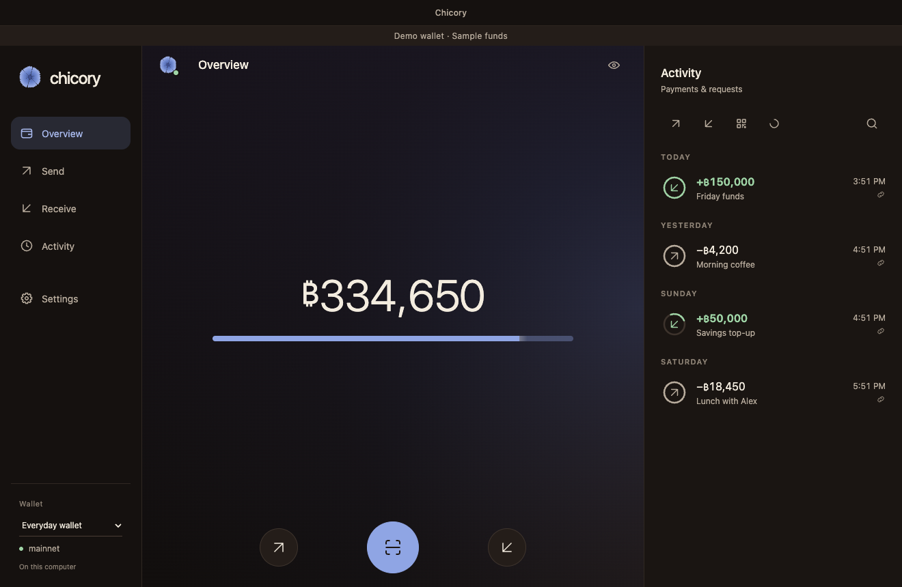

# Chicory Desktop

Chicory's Lightning-first wallet for macOS, Windows and Linux. The desktop app
keeps Chicory's warm palette, bloom glyphs, quiet balance updates and spring
animations, with a workspace designed for a keyboard, pointer and wider window.
The Beignet wallet runs on this computer.



## A desktop workspace

- A persistent navigation rail, network status and Activity column. The rail
  becomes compact in narrower windows, while payment forms keep readable widths.
- Native window controls and menus, remembered window placement, standard text
  editing and keyboard navigation. Use Command on macOS or Control elsewhere:
  `1` Overview, `2` Send, `3` Receive, `4` Activity, and `,` Settings.
- Chicory's original balance, amount entry, payment review, QR, receipt and
  recovery flows, including pointer or keyboard hold confirmation.
- The existing motion engine, interrupted springs and reduced-motion behavior.
  QR fallback decoding loads only when the scanner needs it.
- `bitcoin:` and `lightning:` links can fill an open wallet's Send form. Links
  never review or pay automatically and are dropped when no wallet is ready.
- An explicit sample-wallet mode with isolated preferences and no wallet service.
  Demo balances are always labelled and never replace a failed live connection.

## Run from source

Use Node 24.22.1 and npm. The Electron install downloads its matching runtime.

```sh
npm ci
npm --prefix server ci
npm run runtime:prepare
npm run build
npm start
```

`runtime:prepare` downloads an official Node release, checks its pinned SHA256,
installs the pinned Beignet 0.38.0 engine from a lockfile, applies the reviewed
fresh-address, zero-reserve and encrypted-storage patches, builds the pinned encrypted SQLite
driver, and verifies real encrypted database files. It also downloads and verifies
the pinned official Tor Expert Bundle. Building the driver requires a C++ toolchain
and Python. On Windows it also builds the app lock's Windows Hello helper, which
needs Visual Studio or its Build Tools with the C++ tools and a Windows SDK.
Packaged apps include these components and need no Node, npm or separate Tor
installation.

On first launch, Chicory creates a mainnet wallet with its default Electrum
server and primary node, and its recovery phrase waits behind the backup banner
until it is saved. Erase all wallets, in Settings, returns to setup, where a
wallet can be restored from its phrase instead. Change the network or servers
in Settings > Network & servers; testnet and regtest need a server entered there
first, and a new wallet on either asks for its primary node. Set
`CHICORY_MANUAL_SETUP=1` to start in setup without creating a wallet. Bundled
Tor starts on demand for onion peers, guardians
and onion Electrum servers. Its bootstrap must succeed before wallet connections
use that route, and onion failures never fall back to a direct connection.
Clearnet peers continue to connect directly; this is not an all-traffic VPN.

To explore the interface without creating a wallet or installing the wallet
runtime:

```sh
npm ci
npm run demo
```

The sample wallet supports Send, Receive, Activity and Settings. Its transactions
and funds are simulated. For renderer development, `npm run web:dev` also serves
the browser preview at `http://127.0.0.1:5173/?demo`.

## Local wallet ownership

The Electron renderer is sandboxed with context isolation and no Node access.
A stable private application origin keeps desktop preferences across launches.
The main process connects to the local manager over an ephemeral loopback port
using a fresh capability. The manager rejects unauthenticated requests, foreign
origins and unexpected Host headers. The renderer never receives that capability
or daemon credentials.

Wallet seeds, channel state and signing remain on this computer. A random storage
key is protected by macOS Keychain, Windows DPAPI or a supported Linux system
keyring through Electron's secure storage. Linux plaintext keyring fallback is
refused. Wallet and guardian databases use SQLCipher-compatible AES-256 page
encryption. Seeds, configuration, manager metadata and wallet logs use
authenticated AES-256-GCM file encryption. Keys travel only through private
process bootstrap channels, never renderer IPC or command-line arguments.

This version targets fresh encrypted profiles and contains no legacy wallet
migration. A missing or unreadable key never silently creates a replacement for
existing data. Native app lock and biometric approval remain future work. OS
protection does not isolate an unlocked wallet from every process running as the
same user. Renderer preferences and offline draft caches are a separate pending
privacy improvement. Do not run the same Lightning wallet concurrently on
another device.

Engine database backups retain page encryption and require the original desktop
profile key. A recovery phrase alone cannot decrypt those files on another
installation. The existing passphrase-encrypted identity/settings export is
portable, but it is not a full channel backup. Portable full-wallet encrypted
exports are tracked in the issue backlog.

On macOS, closing the window leaves Chicory running in the Dock. Quit Chicory
stops its wallet daemons and closes the app. On Windows and Linux, closing the
window quits. Receiving while the app is quit is limited to explicitly prepared,
supported offline requests. This app does not claim an independent watchtower.

Normal data is stored in `Chicory Desktop` under the OS application-data folder.
Demo data uses `Chicory Desktop Demo`. Developers can set `CHICORY_PROFILE_DIR`
to an isolated directory for testing. Existing phone and Umbrel wallets are not
opened or migrated automatically.

## Build desktop packages

Build on the target operating system and architecture:

```sh
npm ci
npm --prefix server ci
npm run runtime:prepare
npm run package
npm run dist
```

`package` creates an unpacked application in `release/`; `dist` builds the host's
development-labelled DMG/ZIP, NSIS installer or AppImage. Packaging checks that the bundled Node,
engine, encrypted SQLite driver and Tor match the target. On macOS without a Developer ID,
add `-c.mac.identity=-` to an `electron-builder` command for an ad hoc local build.

The [package workflow](.github/workflows/package.yml) builds development
artifacts for macOS Apple Silicon, macOS Intel, Windows x64 and Linux x64 on
their respective hosts. They are not notarized or Windows signed, and they never
update. The [release workflow](.github/workflows/release.yml) builds signed
releases with a verified update manifest once the owner configures signing. No
signed release has been published yet. See [releases](docs/releases.md).

## Verification

```sh
npm run check
npm run test:smoke
```

Checks cover TypeScript, shared UI behavior, motion, manager routes, payment
safeguards, local authentication, lifecycle and desktop policy. The Electron
smoke test uses a disposable sample profile, exercises native menus and window
sizes, and writes screenshots and a report to `artifacts/smoke/`.

Remaining mobile parity and release work is tracked in the
[GitHub issues](https://github.com/coreyphillips/chicory-desktop/issues).

See [desktop verification](docs/desktop-verification.md) for the exact checks
performed and remaining platform qualification. The inherited
[regtest report](docs/regtest.md) documents the upstream browser and manager
baseline, not new funded testing of this desktop package.

The [Floresta compatibility lab](docs/floresta-qualification.md) tests a
candidate local Bitcoin backend against Beignet's wallet and Lightning
requirements on a disposable regtest chain.

## Source and license

The desktop adaptation reuses Chicory's production UI and the Chicory Umbrel
layout and manager. Source revisions and dependency pins are in
[sources.json](sources.json). The upstream design contract is preserved in
[REDESIGN.md](web/chicory/REDESIGN.md).

- `desktop/`: native window, restricted preload, protocol transport and policy.
- `web/`: Chicory scenes, desktop layout and browser platform adapters.
- `server/`: local wallet manager, engine supervision and tests.
- `build/` and `scripts/desktop/`: reproducible runtime and platform packaging.
- `docker/`, `store/`, and the older browser verification files: inherited
  deployment references, outside the desktop packaging path.

Application source is MIT. See [LICENSE](LICENSE). Bundled dependencies retain
their own licenses. The Tor bundle includes GPL components and ships its upstream
notices and corresponding source references; see [the pinned manifest](build/tor-manifest.json).
Beignet and the original Chicory sources retain their copyright notices.
